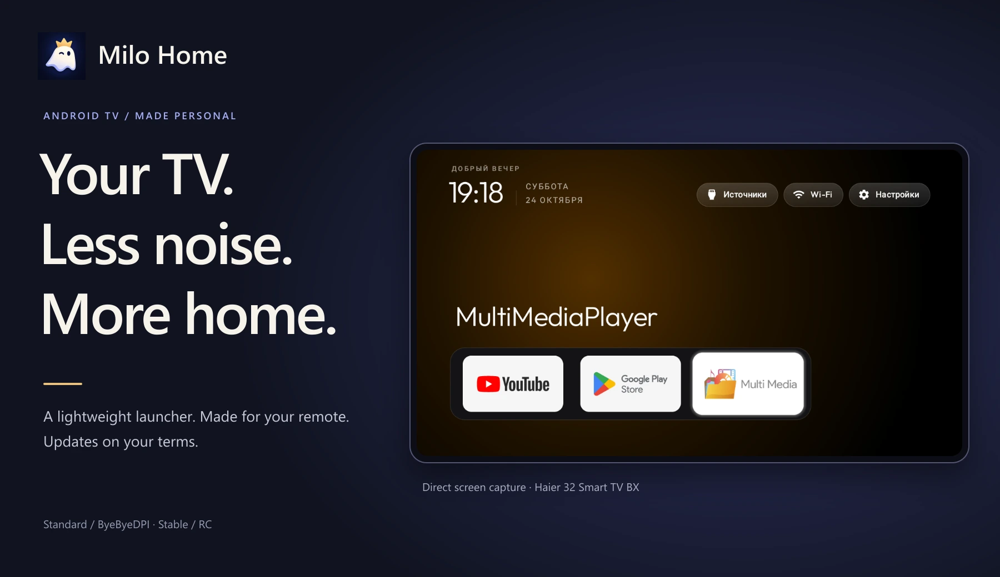
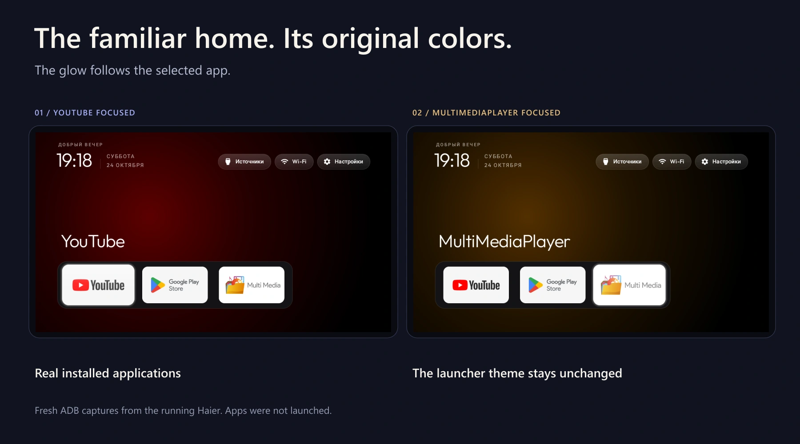

<a href="README.md">Русский</a> · <strong>English</strong>

<h1 align="center">Milo Home</h1>

A calmer home screen for Android TV. Your apps, your remote, and updates on your terms.

<a href="docs/installation/README.en.md"><strong>Install</strong></a> ·
<a href="docs/AI-INSTALL.en.md"><strong>Install with an AI assistant</strong></a> ·
<a href="https://github.com/anrhangels/milo-home/releases">Releases</a> ·
<a href="#screenshots">Screenshots</a>

## Less noise. More you.

Milo Home is an independent Android TV project: a native home screen, familiar remote navigation and verified updates. It develops the code and ideas of **Gathin23**'s [CleanYourTV](https://github.com/Gathin23/cleanyourtv), retaining its lightweight foundation and original layout.

| Your home screen | Network within reach | Updates with a choice |
| --- | --- | --- |
| Large app tiles, a clock, wallpapers and D-pad navigation. No launcher advertising feed. | The Wi-Fi button opens network settings and control of the paired ByeByeDPI build. | Stable or RC, confirmation before downloading and a circular indicator based on actual received bytes. |

There is no persistent updater service. Launch-time checks are asynchronous, with a 24-hour success cache. Downloads are checked for SHA-256, cryptographic signature, package identity, version and compatibility before opening Android's standard installer.

## The interface, in use

The cover and gallery use fresh direct ADB captures from the running Haier 32 Smart TV BX. App tiles and interface content were not painted in. Decorative frames stay outside the screen.

*Left: YouTube focused. Right: MultiMediaPlayer focused. The original glow follows the selected app; neither app was launched. The Haier keeps its compatible working build; new editions were tested separately on an emulator.*

<strong>Original captures without decorative frames</strong>

[YouTube focused](docs/screenshots/haier-home-fresh.png) · [MultiMediaPlayer focused](docs/screenshots/haier-media-fresh.png) · [New ByeByeDPI menu](docs/screenshots/byedpi-network.png) · [New RC](docs/screenshots/standard-rc-menu.png).

[Capture provenance](docs/screenshots/README.md) · [Branding](docs/brand/README.md).

## Choose how to install

| With an AI assistant | On your own |
| --- | --- |
| [Copyable prompt and workflow](docs/AI-INSTALL.en.md). The assistant inspects the device, APK and signing identity before preparing a concrete plan. | [Windows](docs/installation/windows.en.md) · [Linux](docs/installation/linux.en.md) · [macOS](docs/installation/macos.en.md). Official ADB, file verification, state records and first launch. |

### Choose your edition

| Edition | Stable 1.2.0 | RC 1.3.0-rc.1 |
| --- | --- | --- |
| **Standard** — no ByeByeDPI control; Wi-Fi opens system settings | [Download](https://github.com/anrhangels/milo-home/releases/tag/standard-v1.2.0) | [Preview](https://github.com/anrhangels/milo-home/releases/tag/standard-v1.3.0-rc.1) |
| **ByeByeDPI** — paired backend network menu | [Download](https://github.com/anrhangels/milo-home/releases/tag/byedpi-v1.2.0) | [Preview](https://github.com/anrhangels/milo-home/releases/tag/byedpi-v1.3.0-rc.1) |

Both editions include the new icon. They are alternative builds of one app; the updater only offers its own edition. Choose Stable for everyday use. [Channels](docs/RELEASE_CHANNELS.md).

> An in-place update requires a compatible signing identity. With a different certificate, prepare a working fallback HOME and migration plan first: reinstalling deletes app data. [Signing and initial migration →](docs/SIGNING.en.md)

The [installation overview](docs/installation/README.en.md) covers compatibility, HOME selection and returning to the original screen. A new launcher does not require removing the factory launcher. Installation itself does not select HOME or disable system packages.

### Using ByeByeDPI

The network menu requires the **paired modified backend**, signed with the coordinated identity. The stock official ByeByeDPI APK does not expose this protected interface. Install the backend before the launcher; Android VPN consent remains an on-screen confirmation. [Integration and source patch →](docs/BYEBYEDPI.md)

## What has been verified

- **233 launcher tests**, 11 publisher tests, Android Lint and GitHub Actions assembly.
- Four Actions-built APKs verified for signature, hash and edition. Standard Stable1.2.0 → RC was tested through the updater and standard installer; the ByeByeDPI edition update preserved data and the running backend process.
- App data, UID and HOME preserved during ordinary same-key updates.
- The earlier network-menu build works on Haier / Android11 / ARM32. The new editions have not replaced that working TV installation.

[Evidence and limitations](docs/TESTING.md) · [CI](https://github.com/anrhangels/milo-home/actions) · [All releases](https://github.com/anrhangels/milo-home/releases)

The fresh/default ByeByeDPI emulator profile interrupted GitHub TLS. Actual online delivery was tested with manual OFF; the launcher never disables VPN automatically. Android8+ is the build minimum, not certification for every vendor firmware.

## Documentation

| Get started | Build and release |
| --- | --- |
| [Installation](docs/installation/README.en.md) · [AI-assisted installation](docs/AI-INSTALL.en.md) | [Building](docs/BUILDING.md) · [Contributing](CONTRIBUTING.md) |
| [Updating](docs/UPDATING.md) · [Recovery](docs/ROLLBACK.md) | [Channels and Actions](docs/RELEASE_CHANNELS.md) · [Signing](docs/SIGNING.en.md) |
| [ByeByeDPI](docs/BYEBYEDPI.md) · [Testing](docs/TESTING.md) | [Changelog](CHANGELOG.md) · [Security](SECURITY.md) |

---

**Original project:** [Gathin23 / CleanYourTV](https://github.com/Gathin23/cleanyourtv). **Milo Home development and maintenance:** [anrhangels](https://github.com/anrhangels), with assistance from **OpenAI Codex**. The mascot was supplied by the project owner; the new visual adaptation uses OpenAI image generation.

The original [MIT licence](LICENSE) and attribution are preserved. The separate ByeByeDPI patch is GPLv3. [Credits and licences](CREDITS.md). This is an independent project, not an official CleanYourTV release.
