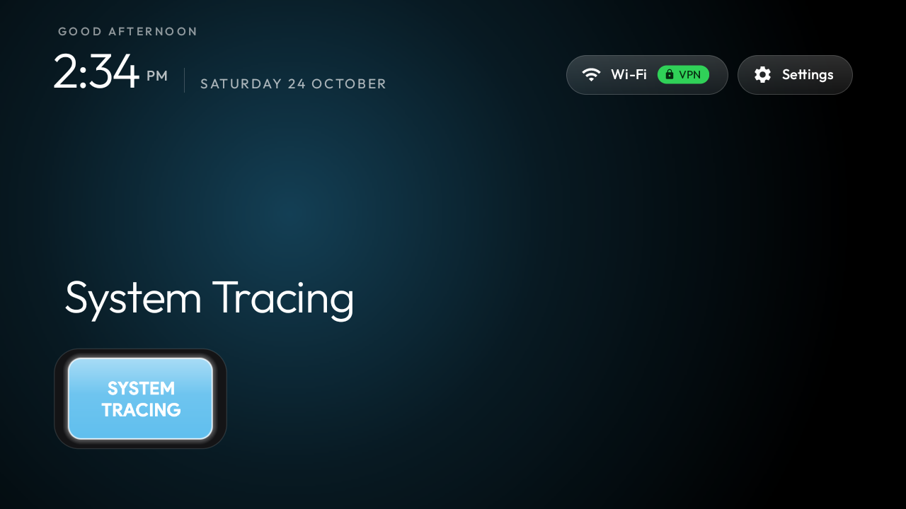
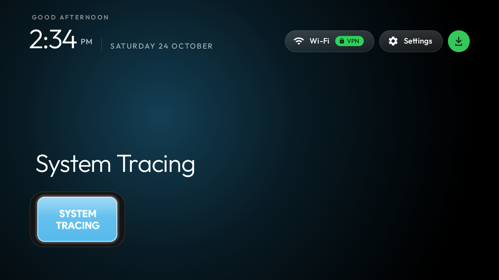
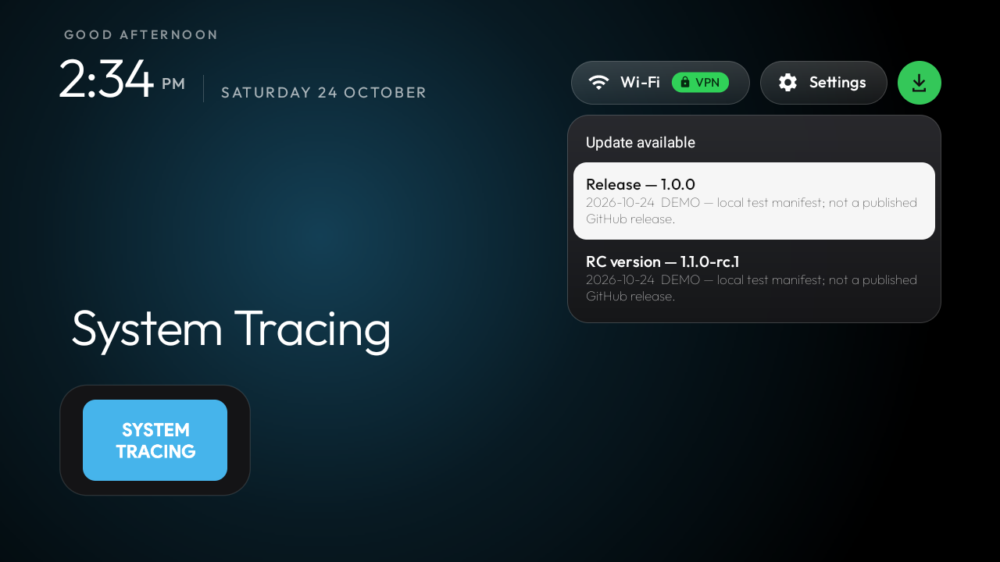
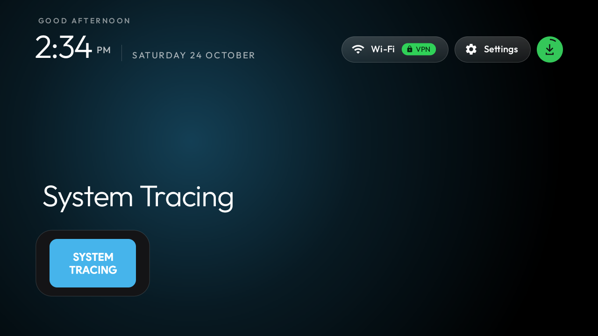

# Milo Home

**An independent modification of [CleanYourTV](https://github.com/Gathin23/cleanyourtv) by Gathin23.**
Developed and maintained by [anrhangels](https://github.com/anrhangels), with development assistance from **OpenAI Codex**.

[Русская версия](README.ru.md) · [Updating](docs/UPDATING.md) · [Building](docs/BUILDING.md) · [Signing and migration](docs/SIGNING.md)

Milo Home retains the native Java launcher, themes, wallpapers and remote navigation of CleanYourTV,
and adds an event-driven ByeByeDPI network menu and an explicitly confirmed GitHub Releases updater.
It is not an official CleanYourTV release and is not endorsed by its original author or by OpenAI.

## Features

- Existing Wi-Fi button opens two rows: ByeByeDPI control/status and the TV's Wi-Fi settings.
- Protected IPC with the paired ByeByeDPI modification; no Accessibility automation.
- A green update button **to the right of Settings**, hidden when neither channel offers a compatible newer APK.
- Separate **Release** and **RC** choices, confirmation before downloading, and byte-based circular progress.
- HTTPS GitHub REST metadata, APK SHA-256 and cryptographic signature verification, package/version/API/ABI checks,
  followed by the ordinary Android installer. No GitHub token or separate server in the app.
- Background check on launch, a 24-hour successful-check cache, failure/rate-limit backoff, manual check in launcher settings.
- No updater service, alarm, boot receiver, background polling or theme/wallpaper replacement.

## Status and device scope

The prior network-menu modification has been tested on a Haier 32 Smart TV BX, Android 11, ARM32,
approximately 907 MiB RAM. The new updater is under isolated Android 11 emulator testing.
Do not interpret emulator results as Haier installer, reboot or performance certification.
Android 8+ is the build minimum, not a guarantee for every vendor's installer or remote.

## Screenshots

These are **actual Android 11 emulator captures**. Update rows use a clearly labelled local test manifest;
they are UI/download-verification demonstrations, not proof of a published GitHub release or Haier installation.
The baseline wallpaper is unchanged. No personal network names or device addresses are shown.

| Home | Compatible update available |
|---|---|
|  |  |

| Release / RC | Confirmation |
|---|---|
|  |  |

## Installation

Read [signing and initial migration](docs/SIGNING.md) **before** installing over an existing launcher.
The package remains `com.gathin.tvhome`. Ordinary updates require the same signing identity and a higher
Android `versionCode`; a fresh permanent key is not automatically compatible with an old debug-signed app.
Do not uninstall your launcher to work around this check.

ByeByeDPI control requires the **paired modified backend**, signed with the corresponding key.
The stock official romanvht APK does not expose this protected IPC. Install the paired backend first,
then Milo Home so Android can grant the signature permission. See [integration notes](docs/BYEBYEDPI.md).
Installing the launcher does not enable a VPN, change HOME, disable/enable system packages or rerun debloat.

## Releases

Public fork: [`anrhangels/milo-home`](https://github.com/anrhangels/milo-home).
[Releases](https://github.com/anrhangels/milo-home/releases) · [Actions](https://github.com/anrhangels/milo-home/actions).
Test-track releases are explicitly labelled and never offered by production-track clients.
Stable and RC are both optional, manually confirmed updates; RC is never installed automatically.
The currently published Stable10/RC11 are **isolated test-track builds**, not a migration package for an existing TV.
Actions→Release→download→Android installer was verified for both on an Android11 emulator; see [test evidence](docs/TESTING.md).
The old Haier signing key is unavailable: these APKs cannot update that installation in place.

## Build and contribute

JDK 17, Android SDK 34 and Build Tools 35.0.0. See [BUILDING](docs/BUILDING.md), [CONTRIBUTING](CONTRIBUTING.md)
and [release channels](docs/RELEASE_CHANNELS.md). Signing material and private device backups must stay outside Git.

## Credits and licence

Original launcher: **Gathin23**, [CleanYourTV](https://github.com/Gathin23/cleanyourtv).
Modification owner: **anrhangels**. Development assistance: **OpenAI Codex**, an AI development tool, not a human co-author.
Original MIT copyright/licence and font notices are preserved. AndroidX and apksig notices are in [CREDITS](CREDITS.md).
The separate ByeByeDPI integration patch follows its original GPLv3 licence; the launcher does not embed its native code.
