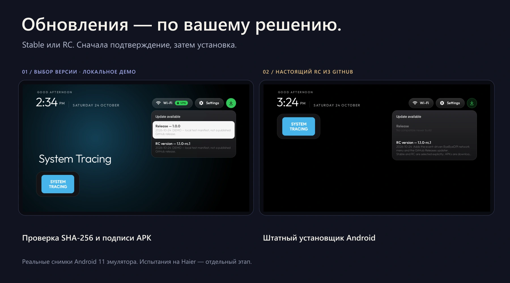

<strong>Русский</strong> · <a href="README.en.md">English</a>

<h1 align="center">Milo Home</h1>

Спокойный домашний экран для Android TV. Ваши приложения, привычный пульт и обновления под вашим контролем.

<a href="docs/installation/README.md"><strong>Установить</strong></a> ·
<a href="docs/AI-INSTALL.ru.md"><strong>Установить с ИИ</strong></a> ·
<a href="https://github.com/anrhangels/milo-home/releases">Релизы</a> ·
<a href="#screenshots">Интерфейс</a>

## Меньше шума. Больше вашего.

Milo Home — независимый форк [CleanYourTV](https://github.com/Gathin23/cleanyourtv) от **Gathin23**. Сохраняет нативный Java-интерфейс, темы и управление пультом; добавляет удобное меню сети и проверяемые обновления из GitHub.

| Домашний экран | Сеть рядом | Обновления с выбором |
| --- | --- | --- |
| Крупные карточки приложений, часы, обои и навигация стрелками. Без рекламной ленты лаунчера. | Кнопка Wi-Fi открывает настройки сети и управление парной сборкой ByeByeDPI. | Stable или RC, подтверждение перед загрузкой и круговой прогресс по полученным байтам. |

Никакой постоянной службы обновлений: проверка запускается асинхронно, успешный результат хранится 24 часа. APK проверяется по SHA-256, цифровой подписи, идентификатору, версии и совместимости, затем открывается обычный установщик Android.

## Так это выглядит

На обложке — ваш реальный снимок Haier 32 Smart TV BX, оформленный в новую палитру проекта. Сам интерфейс на фотографии не перерисован.

*Слева — демонстрация меню с помеченными тестовыми данными. Справа — реальный RC из опубликованного GitHub Release. Оба кадра сняты с Android 11 эмулятора.*

<strong>Все оригинальные кадры и происхождение изображений</strong>

- [Фото Haier](docs/screenshots/haier-user-photo.webp) · [Домашний экран](docs/screenshots/home.png)
- [Выбор канала](docs/screenshots/update-channels.png) · [Подтверждение](docs/screenshots/update-confirm.png) · [Прогресс](docs/screenshots/update-progress.png)
- [Настоящий RC](docs/screenshots/online-rc-menu.png) · [Установщик Android](docs/screenshots/online-rc-installer.png)
- [Как сделаны снимки](docs/screenshots/README.md) · [Маскот и оформление](docs/brand/README.md)

## Установка — выберите свой способ

| С помощью ИИ | Самостоятельно |
| --- | --- |
| [Готовый промпт и порядок работы](docs/AI-INSTALL.ru.md). Ассистент сначала проверяет устройство, APK и подпись, затем предлагает конкретный план. | [Windows](docs/installation/windows.md) · [Linux](docs/installation/linux.md) · [macOS](docs/installation/macos.md). Официальный ADB, проверка файла, резервные сведения и первый запуск. |

> **Сейчас опубликованы только тестовые Stable 10 и RC 11.** Они предназначены для изолированных испытаний. Production-релиза пока нет. Эти APK не обновляют нынешний Haier поверх установленного лаунчера: старый ключ подписи не найден. [Статус подписей и миграции →](docs/SIGNING.md)

[Общая инструкция](docs/installation/README.md) объясняет проверку совместимости, выбор HOME и возврат к прежнему экрану. Новый лаунчер не требует удаления заводского. Установка сама по себе не переназначает HOME и не отключает системные пакеты.

### Если нужен ByeByeDPI

Меню сети работает с **парной модифицированной сборкой**, подписанной согласованным ключом. Обычный APK ByeByeDPI не предоставляет этот защищённый интерфейс. Backend устанавливается перед лаунчером; разрешение VPN подтверждается на экране Android. [Интеграция и исходный патч →](docs/BYEBYEDPI.md)

## Что уже проверено

- **231 тест лаунчера**, 9 тестов выпуска, Android Lint и сборка в GitHub Actions.
- Настоящая цепочка **Actions → Release → загрузка → проверка APK → установщик**, Stable 10 → RC 11 на Android 11 эмуляторе.
- Сохранение данных, UID и HOME при обычном обновлении с одинаковой подписью.
- Предыдущая сетевая модификация работает на Haier / Android 11 / ARM32. Новый обновлятор на физический ТВ ещё не установлен.

[Результаты и ограничения](docs/TESTING.md) · [CI](https://github.com/anrhangels/milo-home/actions) · [Тестовые релизы](https://github.com/anrhangels/milo-home/releases)

С профилем ByeByeDPI по умолчанию на эмуляторе GitHub обрывал TLS-соединение. Онлайн-доставка проверена при ручном OFF; лаунчер не выключает VPN автоматически. Android 8+ — минимум сборки, а не гарантия для каждой прошивки.

## Документация

| Начать пользоваться | Разрабатывать и выпускать |
| --- | --- |
| [Установка](docs/installation/README.md) · [Установка с ИИ](docs/AI-INSTALL.ru.md) | [Сборка](docs/BUILDING.md) · [Участие](CONTRIBUTING.md) |
| [Обновления](docs/UPDATING.md) · [Восстановление](docs/ROLLBACK.md) | [Каналы и Actions](docs/RELEASE_CHANNELS.md) · [Подпись](docs/SIGNING.md) |
| [ByeByeDPI](docs/BYEBYEDPI.md) · [Проверки](docs/TESTING.md) | [История изменений](CHANGELOG.md) · [Безопасность](SECURITY.md) |

---

**Основа:** [Gathin23 / CleanYourTV](https://github.com/Gathin23/cleanyourtv). **Разработка форка и сопровождение:** [anrhangels](https://github.com/anrhangels), при помощи **OpenAI Codex**. Маскот предоставлен владельцем проекта; графическая адаптация выполнена с помощью генерации изображений OpenAI.

Оригинальная [MIT License](LICENSE) и авторство сохранены. Патч ByeByeDPI распространяется отдельно под GPLv3. [Все благодарности и лицензии](CREDITS.md). Независимый проект, не официальный релиз CleanYourTV.
