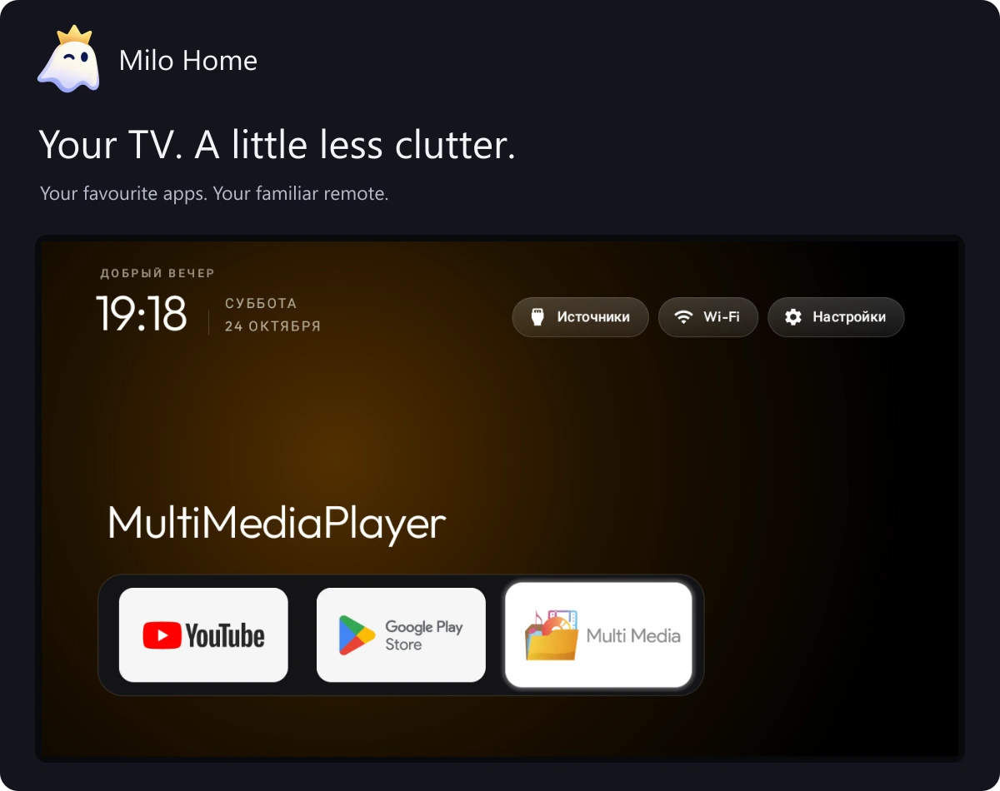
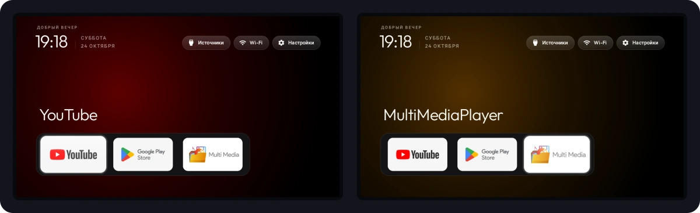

<strong>English</strong> · <a href="README.ru.md">Русский</a> · <a href="docs/installation/languages.md">Installation in 26 languages</a>

<h1 align="center">Make room for your TV.</h1>

A simple, lightweight home screen for Android TV. Your favourite apps. Your remote. A calmer place to start.

<a href="https://github.com/anrhangels/milo-home/releases/tag/v0.0.3"><strong>Download Milo Home</strong></a> · <a href="docs/START.md"><strong>How to install</strong></a> · <a href="#other-options">Other downloads</a>

## Less to get in your way

- **Your apps, up front.** Large tiles and familiar remote controls.
- **A quieter home.** No launcher advertising feed or endless recommendations.
- **Your choice to update.** Milo asks before downloading and installing.

For Android TV / Google TV running Android 8 or later. Some TVs restrict changing the home screen. Milo replaces the home screen, not the whole operating system; it cannot promise to fix every source of slowdown.

*Real screen captures from Haier 32 Smart TV BX, using its earlier compatible build. New release editions were tested separately on an emulator. [Original images and details](docs/screenshots/README.md).*

## Start in three steps

1. **Download** the recommended Stable version.
2. **Install** using the illustrated guide for Windows, Linux or macOS.
3. **Try it with your remote**, then choose Milo as your home screen.

Keep the original launcher available so you can switch back. Already using CleanYourTV or an older Milo? [Check before replacing it](docs/SIGNING.en.md).

[Open the installation guide →](docs/START.md) · [Install with an AI assistant](docs/AI-INSTALL.en.md)

## Pick what suits you

| Edition | Download |
| --- | --- |
| **Milo Home 0.0.3** | [Open release](https://github.com/anrhangels/milo-home/releases/tag/v0.0.3) |
| **With ByeByeDPI** | Choose `Milo-Home-ByeByeDPI.apk` in the same release |

One version, two APK options. Install only one. [About the network edition](docs/BYEBYEDPI.md).

## Small project. Open doors.

Milo is maintained by [anrhangels](https://github.com/anrhangels), with room for everyone who wants to help. Report a problem, share your TV model, improve a translation or make something of your own.

[Get help / report a problem](https://github.com/anrhangels/milo-home/issues) · [Contribute or build an extension](docs/DEVELOPERS.md) · [All documentation](docs/README.md)

Milo grows from [CleanYourTV](https://github.com/Gathin23/cleanyourtv), by Gathin. We keep that connection, review useful upstream changes and release Milo independently. [Credits](CREDITS.md) · [MIT license](LICENSE).
