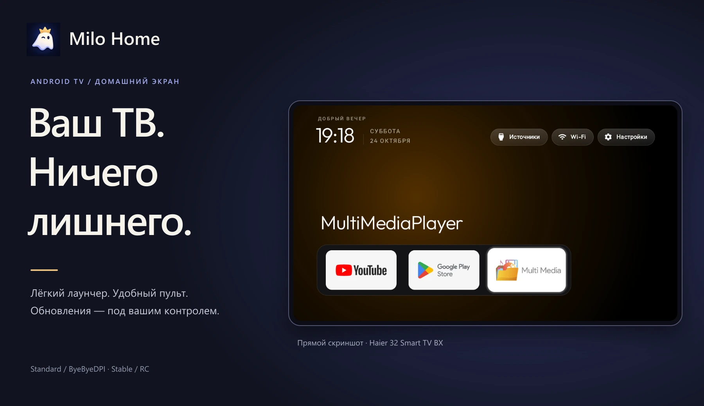
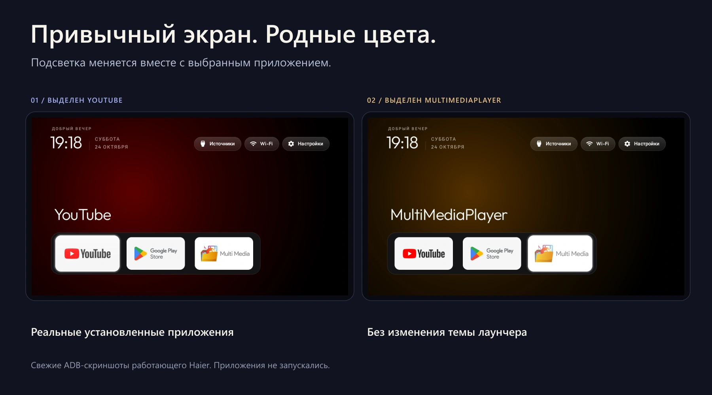

<strong>Русский</strong> · <a href="README.en.md">English</a>

<h1 align="center">Milo Home</h1>

Спокойный домашний экран для Android TV. Ваши приложения, привычный пульт и обновления под вашим контролем.

<a href="docs/installation/README.md"><strong>Установить</strong></a> ·
<a href="docs/AI-INSTALL.ru.md"><strong>Установить с ИИ</strong></a> ·
<a href="https://github.com/anrhangels/milo-home/releases">Релизы</a> ·
<a href="#screenshots">Интерфейс</a>

## Меньше шума. Больше вашего.

Milo Home — самостоятельный проект для Android TV: нативный домашний экран, привычный пульт и проверяемые обновления. Проект развивает код и идеи [CleanYourTV](https://github.com/Gathin23/cleanyourtv) от **Gathin23**, сохраняя его лёгкую основу и штатную раскладку.

| Домашний экран | Сеть рядом | Обновления с выбором |
| --- | --- | --- |
| Крупные карточки приложений, часы, обои и навигация стрелками. Без рекламной ленты лаунчера. | Кнопка Wi-Fi открывает настройки сети и управление парной сборкой ByeByeDPI. | Stable или RC, подтверждение перед загрузкой и круговой прогресс по полученным байтам. |

Никакой постоянной службы обновлений: проверка запускается асинхронно, успешный результат хранится 24 часа. APK проверяется по SHA-256, цифровой подписи, идентификатору, версии и совместимости, затем открывается обычный установщик Android.

## Так это выглядит

На обложке и ниже — свежие прямые ADB-скриншоты работающего Haier 32 Smart TV BX. Интерфейс и приложения не дорисованы. Декоративная рамка находится за пределами экрана.

*Слева выделен YouTube, справа — MultiMediaPlayer. Штатный ореол меняет цвет вместе с карточкой; приложения не запускались. На Haier сохранена его совместимая рабочая версия, новые сборки проверены отдельно на эмуляторе.*

<strong>Оригинальные скриншоты без рамок</strong>

[YouTube в фокусе](docs/screenshots/haier-home-fresh.png) · [MultiMediaPlayer в фокусе](docs/screenshots/haier-media-fresh.png) · [Новое меню ByeByeDPI](docs/screenshots/byedpi-network.png) · [Новый RC](docs/screenshots/standard-rc-menu.png).

[Происхождение снимков](docs/screenshots/README.md) · [Оформление и маскот](docs/brand/README.md).

## Установка — выберите свой способ

| С помощью ИИ | Самостоятельно |
| --- | --- |
| [Готовый промпт и порядок работы](docs/AI-INSTALL.ru.md). Ассистент сначала проверяет устройство, APK и подпись, затем предлагает конкретный план. | [Windows](docs/installation/windows.md) · [Linux](docs/installation/linux.md) · [macOS](docs/installation/macos.md). Официальный ADB, проверка файла, резервные сведения и первый запуск. |

### Выберите свой вариант

| Вариант | Stable 1.2.0 | RC 1.3.0-rc.1 |
| --- | --- | --- |
| **Standard** — без управления ByeByeDPI, кнопка Wi-Fi ведёт в системные настройки | [Скачать](https://github.com/anrhangels/milo-home/releases/tag/standard-v1.2.0) | [Пререлиз](https://github.com/anrhangels/milo-home/releases/tag/standard-v1.3.0-rc.1) |
| **ByeByeDPI** — с меню парного backend | [Скачать](https://github.com/anrhangels/milo-home/releases/tag/byedpi-v1.2.0) | [Пререлиз](https://github.com/anrhangels/milo-home/releases/tag/byedpi-v1.3.0-rc.1) |

Оба варианта получили новый значок. Это альтернативные сборки одного приложения; обновлятор предлагает только свой вариант. Для обычного использования выбирайте Stable. Подробности — в [описании каналов](docs/RELEASE_CHANNELS.md).

> Установленную версию можно обновить поверх только при совместимой подписи. При другой подписи сначала подготовьте запасной HOME и план переноса: переустановка удаляет данные приложения. [Проверка и первоначальная миграция →](docs/SIGNING.md)

[Общая инструкция](docs/installation/README.md) объясняет проверку совместимости, выбор HOME и возврат к прежнему экрану. Новый лаунчер не требует удаления заводского. Установка сама по себе не переназначает HOME и не отключает системные пакеты.

### Если нужен ByeByeDPI

Меню сети работает с **парной модифицированной сборкой**, подписанной согласованным ключом. Обычный APK ByeByeDPI не предоставляет этот защищённый интерфейс. Backend устанавливается перед лаунчером; разрешение VPN подтверждается на экране Android. [Интеграция и исходный патч →](docs/BYEBYEDPI.md)

## Что уже проверено

- **233 теста лаунчера**, 11 тестов выпуска, Android Lint и сборка в GitHub Actions.
- Четыре APK собраны Actions и проверены по подписи, хешу и варианту. Standard 1.2.0 → RC проверен через встроенную загрузку и штатный установщик; обновление ByeByeDPI Edition сохранило данные и работающий процесс backend.
- Сохранение данных, UID и HOME при обычном обновлении с одинаковой подписью.
- Предыдущая сетевая модификация работает на Haier / Android 11 / ARM32. Новые варианты не заменяли рабочую установку этого ТВ.

[Результаты и ограничения](docs/TESTING.md) · [CI](https://github.com/anrhangels/milo-home/actions) · [Все релизы](https://github.com/anrhangels/milo-home/releases)

С профилем ByeByeDPI по умолчанию на эмуляторе GitHub обрывал TLS-соединение. Онлайн-доставка проверена при ручном OFF; лаунчер не выключает VPN автоматически. Android 8+ — минимум сборки, а не гарантия для каждой прошивки.

## Документация

| Начать пользоваться | Разрабатывать и выпускать |
| --- | --- |
| [Установка](docs/installation/README.md) · [Установка с ИИ](docs/AI-INSTALL.ru.md) | [Сборка](docs/BUILDING.md) · [Участие](CONTRIBUTING.md) |
| [Обновления](docs/UPDATING.md) · [Восстановление](docs/ROLLBACK.md) | [Каналы и Actions](docs/RELEASE_CHANNELS.md) · [Подпись](docs/SIGNING.md) |
| [ByeByeDPI](docs/BYEBYEDPI.md) · [Проверки](docs/TESTING.md) | [История изменений](CHANGELOG.md) · [Безопасность](SECURITY.md) |

---

**Основа:** [Gathin23 / CleanYourTV](https://github.com/Gathin23/cleanyourtv). **Разработка Milo Home и сопровождение:** [anrhangels](https://github.com/anrhangels), при помощи **OpenAI Codex**. Маскот предоставлен владельцем проекта; графическая адаптация выполнена с помощью генерации изображений OpenAI.

Оригинальная [MIT License](LICENSE) и авторство сохранены. Патч ByeByeDPI распространяется отдельно под GPLv3. [Все благодарности и лицензии](CREDITS.md). Самостоятельный проект с сохранённым авторством исходной основы.
