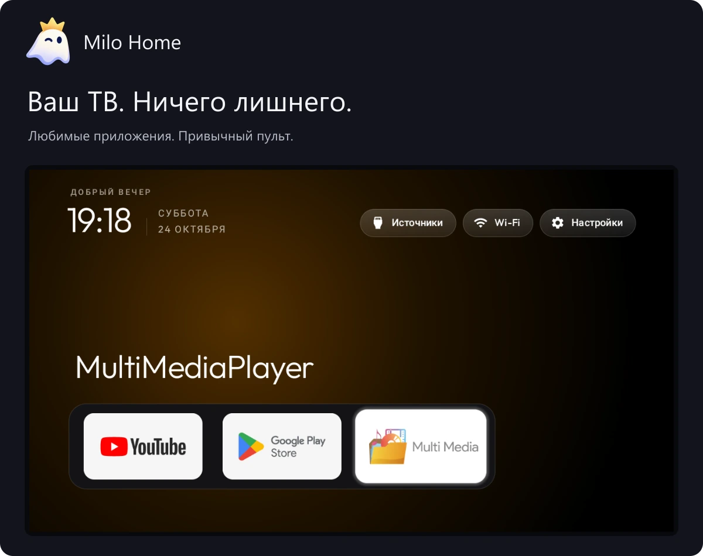

<a href="README.md">English</a> · <strong>Русский</strong> · <a href="docs/installation/languages.md">Установка на 26 языках</a>

<h1 align="center">Больше места для вашего ТВ.</h1>

Простой и лёгкий домашний экран для Android TV. Любимые приложения. Привычный пульт. Ничего лишнего.

<a href="https://github.com/anrhangels/milo-home/releases/tag/v0.0.3"><strong>Скачать Milo Home</strong></a> · <a href="docs/START.ru.md"><strong>Как установить</strong></a> · <a href="#другие-варианты">Другие версии</a>

## Всё нужное — под рукой

- **Ваши приложения на первом месте.** Крупные карточки и привычное управление пультом.
- **Спокойный домашний экран.** Без рекламной ленты лаунчера и бесконечных рекомендаций.
- **Обновления по вашему решению.** Загрузка и установка — после подтверждения.

Для Android TV / Google TV на Android 8 и новее. Некоторые телевизоры ограничивают выбор домашнего экрана. Milo заменяет лаунчер, а не всю систему: он не обещает устранить любые причины зависаний.

*Настоящие скриншоты Haier 32 Smart TV BX с его прежней совместимой версией. Новые выпуски отдельно проверены на эмуляторе. [Исходные снимки и подробности](docs/screenshots/README.md).*

## Три шага до нового экрана

1. **Скачайте** рекомендуемую Stable-версию.
2. **Установите** по инструкции с картинками для Windows, Linux или macOS.
3. **Попробуйте с пульта**, затем выберите Milo домашним экраном.

Оставьте заводской лаунчер доступным, чтобы можно было вернуться. Уже пользуетесь CleanYourTV или старым Milo? [Сначала проверьте совместимость](docs/SIGNING.md).

[Открыть инструкцию →](docs/START.ru.md) · [Установка с помощью ИИ](docs/AI-INSTALL.ru.md)

## Другие варианты

| Вариант | Скачать |
| --- | --- |
| **Milo Home 0.0.3** | [Открыть релиз](https://github.com/anrhangels/milo-home/releases/tag/v0.0.3) |
| **С ByeByeDPI** | В том же релизе выберите `Milo-Home-ByeByeDPI.apk` |

Одна версия, два варианта APK. Устанавливайте только один. [О сетевой версии](docs/BYEBYEDPI.md).

## Небольшой проект, открытый для всех

Milo развивает [anrhangels](https://github.com/anrhangels). Здесь можно помочь: сообщить об ошибке, рассказать о своём телевизоре, поправить перевод или создать расширение.

[Помощь и ошибки](https://github.com/anrhangels/milo-home/issues) · [Для разработчиков](docs/DEVELOPERS.md) · [Вся документация](docs/README.md)

В основе Milo — [CleanYourTV](https://github.com/Gathin23/cleanyourtv) автора Gathin. Мы сохраняем связь, рассматриваем полезные исправления оригинала и выпускаем Milo независимо. [Благодарности](CREDITS.md) · [Лицензия MIT](LICENSE).
