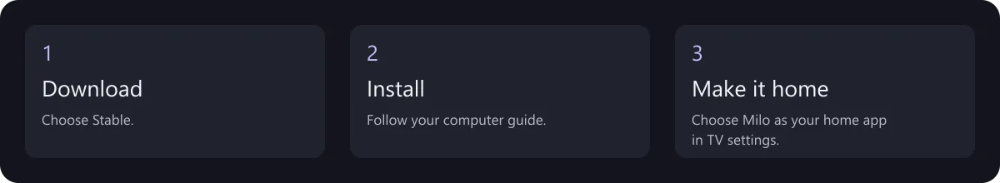

# Install Milo Home

[Home](../README.md) · [Русский](START.ru.md) · [26 languages](installation/languages.md)

You need an Android TV / Google TV (Android 8+), a computer and a way to connect them using Android debugging. Allow about 15–30 minutes for a first installation; device restrictions can make it longer.

## 1. Download the recommended version

Open [Milo Home 0.0.4](https://github.com/anrhangels/milo-home/releases/tag/v0.0.4). Under **Assets**, download `Milo-Home.apk`.

Already have Milo or CleanYourTV installed? [Check compatibility first](SIGNING.en.md). If Android rejects the signature, stop: deleting the app also deletes its settings.

## 2. Follow the guide for your computer

[Windows →](installation/windows.en.md) · [Linux →](installation/linux.en.md) · [macOS →](installation/macos.en.md)

The guide shows how to prepare the connection, approve debugging on the TV, verify the download and install it. The address and debugging menu differ between TVs. Never paste an example address as if it were yours.

Prefer help? [Copy the AI installation request](AI-INSTALL.en.md). The assistant still needs to check your device and ask before making changes.

## 3. Try Milo before making it your home

*Actual screen capture; your apps and language will differ.*

Open Milo from your app list. Test directions, OK, Back and Settings using the physical remote. Then choose Milo in the device's **default home app** settings, if supported. Keep the factory launcher installed and available.

## Change your mind?

Choose the original home app in system settings. This switches the home screen without deleting your apps. If that option is unavailable, use your device's saved recovery route; [recovery details](ROLLBACK.md).

## Something did not work?

| What you see | What to do |
| --- | --- |
| TV asks to allow debugging | Check that it is your computer and confirm on the TV |
| Connection refused / device not found | Check the TV address, debugging mode and actual connection port |
| App not installed / incompatible signature | Stop and read [migration](SIGNING.en.md); do not uninstall automatically |
| Cannot select a home app | Check manufacturer restrictions; installation does not guarantee HOME selection |

[Ask for help](https://github.com/anrhangels/milo-home/issues). Include the TV model, Android version and error text. Hide account, network and other private details.
