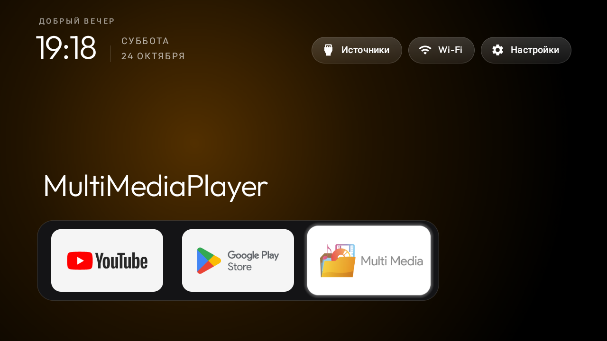

# Установить Milo Home

[Главная](../README.ru.md) · [English](START.md) · [26 языков](installation/languages.md)

Понадобятся Android TV / Google TV на Android 8 или новее, компьютер и подключение через отладку Android. Для первой установки ориентируйтесь на 15–30 минут; ограничения конкретного ТВ могут увеличить время.

## 1. Скачайте рекомендуемую версию

Откройте [Milo Home 0.0.5](https://github.com/anrhangels/milo-home/releases/tag/v0.0.5). В разделе **Assets** скачайте `Milo-Home.apk`.

Уже установлен Milo или CleanYourTV? [Сначала проверьте совместимость](SIGNING.md). Если Android отклоняет подпись, остановитесь: удаление приложения удалит и его настройки.

## 2. Откройте инструкцию для вашего компьютера

[Windows →](installation/windows.md) · [Linux →](installation/linux.md) · [macOS →](installation/macos.md)

Там по шагам показаны подключение, разрешение отладки на экране ТВ, проверка скачанного файла и установка. Меню отладки и адрес у каждого устройства свои — не копируйте адрес из примера как собственный.

Нужна помощь? [Скопируйте запрос для ИИ](AI-INSTALL.ru.md). Ассистент должен проверить устройство и согласовать изменения перед установкой.

## 3. Попробуйте Milo и выберите его домашним экраном

*Настоящий скриншот; ваши приложения и язык могут отличаться.*

Откройте Milo в списке приложений. Проверьте стрелки, OK, Назад и Настройки физическим пультом. Затем выберите Milo в системных настройках **домашнего приложения по умолчанию**, если прошивка позволяет. Заводской лаунчер оставьте установленным и доступным.

## Как вернуться назад?

Выберите прежнее домашнее приложение в настройках системы. Приложения при этом не удаляются. Если выбора нет, используйте заранее сохранённый способ возврата для своего ТВ. [Подробности восстановления](ROLLBACK.md).

## Если не получилось

| Что произошло | Что делать |
| --- | --- |
| ТВ просит разрешить отладку | Убедитесь, что это ваш компьютер, и подтвердите на ТВ |
| Устройство не найдено / соединение отклонено | Проверьте адрес ТВ, режим отладки и настоящий порт подключения |
| Приложение не установлено / другая подпись | Остановитесь и откройте [план перехода](SIGNING.md); не удаляйте автоматически |
| Нет выбора домашнего приложения | Проверьте ограничения производителя: установка не гарантирует смену HOME |

[Обратиться за помощью](https://github.com/anrhangels/milo-home/issues). Укажите модель, версию Android и текст ошибки. Скройте личные данные аккаунтов и сети.
